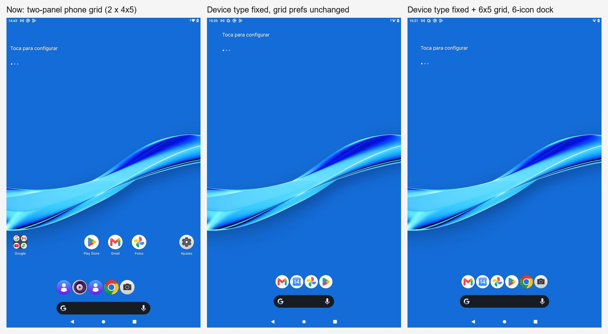
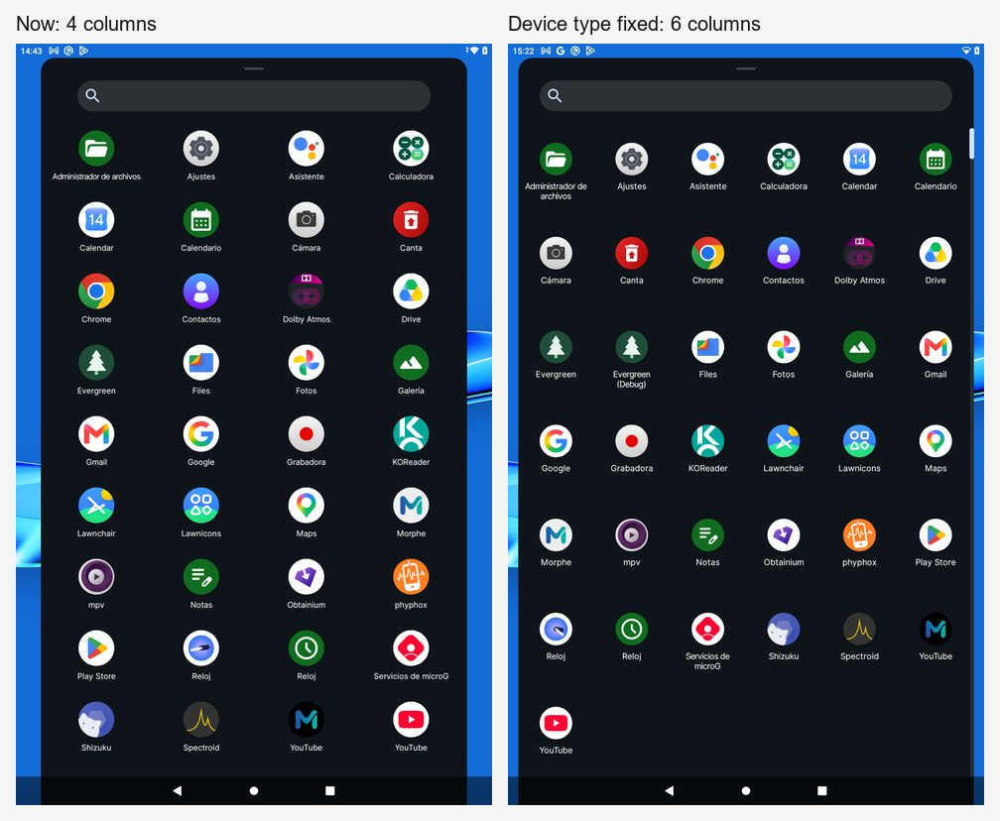
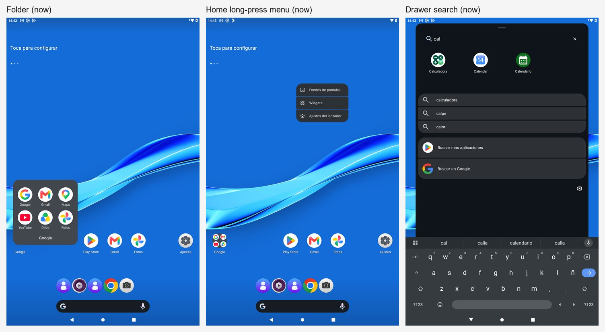

# Evergreen tablet pass: analysis and implementation plan

- **Date:** 2026-11-14. **Build analysed:** `evergreen` at `4211efc` (same tree as `perf/android10` at `fdc054e`).
- **Status:** implemented in #12-#18 (see the backlog's implementation status and
  `docs/perf/RESULTS.md`). Decisions taken: single-panel 6x5 grid with a 6-icon dock for tablets,
  applied once per install and keeping existing layouts; the home screen follows system rotation;
  no Perfetto or overdraw setprop was used. Still open: R2c, R4b, R4c, R5a, V5-V7.
- **Prompt this answers:** `docs/prompts/smooth-and-beautiful-tablet.md`, steps 1–4.

How to read the status labels:

- **DEVICE**: seen on the tablet (measurement, dump or logcat).
- **CODE**: the mechanism was read in the code, but its cost on the tablet is not measured.
- **REVIEW**: reported by a code review subagent and not re-read. Check it before acting on it.
- **HYPOTHESIS**: an explanation that fits the measurements but still needs an A/B build.

## 1. Baseline (unchanged from the last pass)

8 cold starts per mode and 3 `interact.sh` rounds, release APK, Lawnchair as default HOME.

| Metric | Value |
|---|---|
| Cold start, `verify` | 1670 ms (1644–1739), 0 icon fallbacks |
| Cold start, `speed` | 1330 ms (1300–1341), 0 icon fallbacks |
| Page swipes | 1.5% janky (first round 4.3%, then 0.1%), p95 11 ms, p99 14 ms |
| Drawer open/scroll/close | 7.4% janky, p95 19 ms, p99 35 ms |
| Drawer search typing | 14.1% janky, p95 25 ms, p99 48 ms |

## 2. New measurement: everyday interactions

`tools/perf/scenario.sh` covers the interactions `interact.sh` does not, and
`tools/perf/framestats.py` splits every slow frame into stages, so a scenario shows whether the
main thread, the RenderThread or the buffer queue is the bottleneck. No `setprop` is needed.

Baseline, 8 repetitions per scenario (4 for widgets):

| Scenario | Frames | Janky | p50 / p95 / p99 / max | Where the slow frames spend their time |
|---|---|---|---|---|
| `home_intent`: return home like the HOME button | 16 (2 per return) | 56% | 52 / 68 / 68 / 68 ms | first frame: ~40 ms main thread busy before the frame, then ~10 ms layout |
| `home_back`: return home by closing the app | 16 (2 per return) | 56% | 24 / 37 / 37 / 37 ms | ~10 ms layout in both frames, 3–13 ms wait |
| `open_home`: open an app from the home screen | 24 | 21% | 13 / 25 / 28 / 28 ms | 12–22 ms main thread wait before the first frame |
| `open_drawer`: open an app from the drawer | 24 | 29% | 11 / 41 / 54 / 54 ms | 11–46 ms main thread wait before the first frame |
| `drawer_toggle`: open and close the drawer | 430 | 10.9% | 14 / 29 / 36 / 45 ms | GPU stage 5–9 ms on most frames; one ~35 ms frame at the end of every close (13 ms animation callbacks + 10.5 ms layout) |
| `folder`: open and close a folder | 113 | 8.9% | 13 / 20 / 32 / 32 ms | GPU stage 7–15 ms |
| `menu_home`: long-press menu on the home screen | 145 | **59%** | **30** / 79 / 194 / 199 ms | GPU stage 11–14 ms on every frame, so the open animation runs at ~30 fps; first frame waits 40–90 ms |
| `menu_icon`: long-press menu on an icon | 506 | 20% | 13 / 33 / 73 / 111 ms | same GPU pattern; first frame waits 45–78 ms |
| `widgets`: open, scroll and close the widget picker | 462 | 10.4% | 14 / 33 / 107 / 334 ms | 160–180 ms layout and 140–180 ms wait in the opening frames |
| `idle`: 30 s of untouched home screen | 0 | – | – | nothing drawn; the main thread did not wake up in 10 s either |

Notes on the numbers:

- The first folder opens after a process start are much worse: 43% janky over the first two
  repetitions, against 8.9% over eight.
- Returning home costs about 25 ms of lifecycle callbacks before any frame (`am_resume_activity`
  → `am_on_resume_called` in the events log; `onStart` alone is 15 ms).
- `drawer_fling` is not a valid scenario on this tablet: its 36 apps fit on one screen, so a fling
  at the top of the list closes the sheet. It needs a device with more apps.
- Evergreen is not the default HOME during tests, so `home_intent` is the closest reproduction of
  the HOME button.

## 3. Jank sources, ranked by how often they are hit × how bad they are

### R1. Returning home from an app (every app exit)

Measured: 25 ms of lifecycle, then a 52–68 ms first frame and a second frame with another 10 ms
layout pass.

| # | Cause | Evidence | Status |
|---|---|---|---|
| R1a | The feed client binds the Google app on every `onStart`, even with the feed disabled. 3–6 binder calls on the main thread, and the binding holds the Google app at high priority. This is EVG-14, which the backlog had as "no bind observed". | `LauncherClient.java:194-229`, `BaseClientService.java:27-28`. `FEED: 1` / `FEED: 2` in logcat on every return. `dumpsys activity services` shows a `CR IMP` connection from Evergreen to `DrawerOverlayService`. | DEVICE |
| R1b | The smartspace pipeline is cancelled at every stop and restarted at every start (`WhileSubscribed()` with no timeout, collected with `repeatOnLifecycle(STARTED)`). Each fresh emission rebinds cards compared by reference and requests a layout that reaches the root. Fits the two ~10 ms layout passes. | `BcSmartspaceView.kt:80-82,140`, `SmartspaceProvider.kt:30-34`, `CardPagerAdapter.kt:23,49` | REVIEW + matches DEVICE frames |
| R1c | Both widget hosts call the blocking `startListening()` inside the transition window. | `LawnchairLauncher.kt:496`, `Launcher.java:1148` | REVIEW |
| R1d | `onNewIntent` resets the drawer a second time, with blocking preference reads and a forced relayout. | `Launcher.java:1696-1709`, `FastScrollRecyclerView.java:99-103,231-237` | REVIEW |
| R1e | Notifications are fetched in full twice on every resume, and the result triggers one more smartspace emission. Only with notification access. | `NotificationListener.java:240-243`, `NotificationManager.kt:35-51` | REVIEW |

Fix direction: skip `connect()` when the feed flag is off; give the smartspace share a stop
timeout and drop updates that are equal to what is shown; start the widget hosts after the first
frame; use `cachedValue()` for `rememberPosition`.

Acceptance: `home_intent` first frame under 25 ms, no 10 ms layout stage in `home_back`, no `FEED`
log line and no connection to the Google app with the feed off.

### R2. Drawer open/close (the most used launcher animation)

Measured: p50 is already 14 ms, so every frame is close to the budget.

| # | Cause | Evidence | Status |
|---|---|---|---|
| R2a | End of every close: five blocking reads of `rememberPosition` inside `onAnimationEnd`, then a forced relayout. | `ActivityAllAppsContainerView.java:506`, `FastScrollRecyclerView.java:100,231-237`, `FloatingHeaderView.java:387`. The last frame of every close shows 13 ms animation + 10.5 ms layout. | REVIEW + matches DEVICE frames |
| R2b | After a swipe-up open, a "stretch" spring keeps redrawing the whole sheet under a changing canvas scale for ~330 ms. Below API 31 this is a canvas scale, not a RenderEffect. | `StretchRelativeLayout.kt:29-49`, `StretchEdgeEffect.java:396-458`. The trace of one open shows 20 extra frames of 11–16 ms after the finger is released. | REVIEW + matches DEVICE frames |
| R2c | The GPU stage grows from 2 to 9 ms as the sheet covers the screen. Candidates: the workspace hardware layer created at the start plus its full-length fade, and the per-frame root invalidation for the system bar scrim. | `Workspace.java:1693-1745`, `CellLayout.java:371-373`, `SysUiScrim.java:226-231` | HYPOTHESIS |
| R2d | The window title changes with the state, which can force a window relayout. | `Launcher.java:1310-1311` | HYPOTHESIS |

Acceptance: `drawer_toggle` under 5% janky, no ~35 ms frame at the end of a close.

### R3. Long-press menus (worst frame times of the whole launcher)

Measured: `menu_home` runs at ~30 fps for the whole open animation, although the popup is three
rows of 216×52 dp.

| # | Cause | Evidence | Status |
|---|---|---|---|
| R3a | Every row has a 2 dp elevation shadow over a background with per-corner radii (a path outline), while the popup scales from 0.5 to 1.02. The shadow has to be rebuilt on every frame. | `system_shortcut.xml:23`, `deep_shortcut.xml:22`, `dimens.xml:317`, `ArrowPopup.java:163-172,740-782` | CODE; cost is a HYPOTHESIS |
| R3b | The container fades while every row's children fade too, with no `hasOverlappingRendering()` override, so each one becomes a temporary offscreen layer. | `ArrowPopup.java:676-697,755-758` | CODE; cost is a HYPOTHESIS |
| R3c | A 200 ms overshoot (1.02 → 1) keeps the animation, and its cost, running after the popup is open. | `ArrowPopup.java:766-775` | CODE |
| R3d | Icon long-press: a hardware-bitmap drag preview, a `getPackageInfo` call and two blocking preference reads before the popup. | `Workspace.java:1901,1932`, `DragPreviewProvider.java:114-116`, `LawnchairShortcut.kt:45,59-72` | REVIEW; fits the 45–78 ms wait |
| R3e | Home long-press: three blocking preference reads, two `resolveActivity` calls and all six options built. | `LawnchairLauncher.kt:328`, `LauncherOptionsPopup.kt:62-114` | REVIEW; fits the 40–90 ms wait |

A code review concluded that the per-frame GPU load of popups and folders is small. The tablet
says otherwise: the GPU stage dominates 58 of 115 slow `menu_home` frames and 11 of 13 slow
`folder` frames.

First experiment: build with the row elevation at 0 below API 31 and rerun
`scenario.sh <label> <out> menu_home menu_icon`.

Acceptance: `menu_home` under 15% janky with p50 under 16 ms; first frame wait under 20 ms.

### R4. Folder open/close

| # | Cause | Evidence | Status |
|---|---|---|---|
| R4a | One label alpha animator per item re-records every label on every frame, while the content scales (text is drawn at a new scale each frame). | `FolderAnimationManager.java:217-231`, `BubbleTextView.java:874-881` | REVIEW; cost is a HYPOTHESIS |
| R4b | The reveal uses `clipPath` and invalidates two views per frame for icon shapes other than the rounded square. | `IconShape.java:207-211`, `Folder.java:1776-1779` | REVIEW; depends on the icon shape in use (circle on the tablet) |
| R4c | First open: empty `ViewCache` (items inflated in the click handler) and low-res icons upgraded during the animation with a 375 ms cross-fade each. | `ModelCallbacks.kt:148-152`, `WorkspaceItemProcessor.kt:256`, `PlaceHolderIconDrawable.java:58-69` | REVIEW; fits 43% janky on first opens |
| R4d | Blocking preference reads on every open and close. This corrects EVG-17: `Folder.java:316` runs at bind time, not per open. | `FolderAnimationManager.java:188,191`, `ShortcutAndWidgetContainer.java:86-93` | REVIEW |

Acceptance: `folder` under 4% janky over eight repetitions, under 15% on the first two opens.

### R5. Lower frequency

| # | What | Evidence | Status |
|---|---|---|---|
| R5a | Widget picker: one 160–330 ms frame on open (sheet inflated every time, `onWidgetsBound()` twice, double measure). Previews are hardware bitmaps rendered on the RenderThread at full widget size, with no cache. | `WidgetsFullSheet.java:350-353,435-441,694-702`, `DatabaseWidgetPreviewLoader.java:177`, `WidgetCell.java:247-249` | REVIEW + DEVICE frames |
| R5b | Widget picker: workspace and hotseat are scaled to 0.97 on every frame with no layer, the sheet background is drawn twice, and the whole sheet fades in. | `BaseWidgetSheet.java:412-417`, `WidgetsFullSheet.java:192-199,639-649` | REVIEW |
| R5c | App open: a full-resolution icon is loaded for a `FloatingIconView` that is never shown without recents. | `ItemClickHandler.java:432-436`, `QuickstepLauncher.java:1152-1154` | REVIEW |
| R5d | Search typing is still 14% janky. Nothing new was found; the remaining cost is the keyboard. | – | DEVICE |

## 4. Bugs found

| ID | Bug | Evidence | Status |
|---|---|---|---|
| EVG-B2 | **The tablet is treated as a two-display device.** `getRealBounds()` returns empty bounds below API 30. `DisplayController` then holds a 0×0 bound next to the real ones and reports `TYPE_MULTI_DISPLAY`. Result: two-panel home with the phone grid (2 × 4×5, cells of 98×196 dp), a 4-column drawer and a 6-icon dock squeezed into 4 columns. It also makes `RotationHelper` flip between tablet and phone. | `LawnchairWindowManagerProxy.kt:35-48`, `DisplayController.java:413-438,522-537`. The launcher's own log shows the empty bound; the device profile dump shows `isTwoPanels:true`. | DEVICE |
| EVG-B3 | **Accessibility queries crash on Evergreen windows on Android 10.** Evergreen keeps widget ids that were allocated but never bound (no permission to bind). `AppWidgetServiceImpl.getHostedWidgetPackages` then throws a NullPointerException in `system_server` for every accessibility node query. `uiautomator dump` dies with it, and TalkBack very likely fails the same way. | Host 1028 holds ids 478 and 479 with no provider (`dumpsys appwidget`); stack trace in logcat. Allocation: `HeadlessWidgetsManager.kt:116-131`. | DEVICE |
| EVG-B4 | **The date ticker in At a Glance is never cancelled, and every return home adds one more 1 Hz loop.** `ticker` is a function reference, so `postAtTime(ticker)` and `removeCallbacks(ticker)` get different `Runnable` objects. The loops also run in the background. Dormant on the tablet today because the date card is the third card and is not instantiated. | `IcuDateTextView.kt:38,143-155` | CODE; two reviews confirmed it in the compiled bytecode |
| EVG-B5 | Each stop/start cycle leaks `MediaController` callbacks: `onPause()` re-registers them right before the listener is dropped. Only with now-playing active. | `MediaListener.java:58-61,71-82,142` | REVIEW |
| EVG-B6 | Dock search bar: the PendingIntent it extracts on every widget update is never read; a subscription condition is inverted; two preference listeners are never removed and hold the Activity after `recreate()`. | `LawnQsbLayout.kt:60,121-133,165-175` | REVIEW |
| EVG-B7 | `subscribeBlocking` runs its callback twice on subscription (`onEach` sits before `drop(1)`). | `FlowUtils.kt:45-50` | REVIEW |

## 5. What is fine, do not redo

- The idle home screen draws nothing and the main thread stays asleep.
- Page swipes are smooth (0.1% janky after warm-up).
- The tap path does no blocking read or IPC before `startActivity`.
- The drawer sheet never sits at partial alpha on tablets, and its scrim is transparent.
- Clock icons tick once a minute; notification dots update only what changed.
- Still rejected: removing `-dontoptimize`, and cheaper label or icon shadows.

## 6. Visual direction (needs approval)

The two right-hand home screens come from a test build with fresh data, so they have no home
screen icons. Compare the structure: panels, dock and margins.

What the test build showed (`getRealBounds()` returning the estimated bounds below API 30):

| | Now | Device type fixed | Fixed + grid 6×5, dock 6 |
|---|---|---|---|
| Home | two panels of 4×5 | one panel, 4×5 | one panel, 6×5 |
| Cell | 98×196 dp | 155×139 dp | 102×120 dp |
| Icon / label | 65 dp / 13.3 sp | 60 dp / 14 sp | 60 dp / 14 sp |
| Dock | 6 icons, touching | 4 icons, touching | 6 icons, touching |
| Drawer | 4 columns, 716 dp sheet | 6 columns, 765 dp sheet | 6 columns, 765 dp sheet |

Proposed direction, as defaults for tablets only (explicit user settings stay untouched):

| # | Change | Why | Risk |
|---|---|---|---|
| V1 | Fix the device type (EVG-B2) so tablets get the single-panel tablet profile. | Root of the phone look. Also gives the scalable grid and consistent rotation handling. | See the three risks below. |
| V2 | Tablet default grid 6×5 with a 6-icon dock. | Columns 102 dp apart instead of 155 dp; the dock lines up with the grid. | The grid comes from preferences (`PreferenceManager.kt:52-54`), which also name the database file. Changing the default naively resets the home screen at cold start (see below). |
| V3 | Space the dock icons like the home screen columns and make the search bar the same width. | Icons touch today because `recalculateHotseatWidthAndBorderSpace()` returns early on tablets (`DeviceProfile.java:972-974`). | Small AOSP diff. |
| V4 | Drawer: keep 6 columns, cut the row height from 158 dp to about 128 dp, and restore side margins of about 48 dp. | Rows look empty, and the sheet is almost full width because the margin factor is applied twice on scalable grids (`DeviceProfile.java:1524-1548`). | Low. |
| V5 | Folders: use compact cells instead of the home screen cell, and take the background from the wallpaper palette instead of grey. | With no folder style on the tablet profile, folder cells copy the home screen cell (`DeviceProfile.java:1641-1665`). | Low. |
| V6 | Motion: remove the popup overshoot, shorten the popup close from 233 to about 150 ms, and review the 500 ms drawer duration once R2 is fixed. | Crisper, and fewer frames to render. | Judged by eye plus `scenario.sh`. |
| V7 | One corner radius family: 24 dp for sheets, popups and folders, pills for search bars. | Six different radii are in use today. | Low. |

Risks of V1 and V2 that the implementation must handle:

1. **Dock items can be deleted.** With the device type fixed, the dock goes from 6 database slots
   to the preference value (4). `LoaderCursor.java:526-535` rejects items in slots 4 and 5 and
   marks them deleted. The fix must keep 6 slots, or migrate.
2. **A new default grid resets the home screen at cold start.** A different grid means a different
   database file; `ModelDbController.java:288-337` then finds an empty database, skips the
   migration, loads the default layout and deletes the old file. A grid change made from Settings
   at runtime migrates correctly. So the new default may only apply to fresh installs, or must go
   through the runtime migration path.
3. **The home screen starts following the system rotation** on tablets, and the "Allow rotation"
   switch stops having an effect (`RotationHelper.java:178,206-208`).

Also seen while testing: the estimated bounds use a 60 dp bottom inset instead of the real 48 dp
navigation bar. Build the real fix from `Display.getRealSize` and the system bar dimensions.

## 7. Implementation plan (small PRs against `perf/android10`)

Each PR: interleaved before/after rounds, `smoke.sh` clean, `RESULTS.md` and the backlog updated.
Order is by expected gain per risk. Performance PRs come first because the visual PRs change the
layout that the scripts tap.

| PR | Content | Scenarios to measure | Target |
|---|---|---|---|
| 0 | This branch: `scenario.sh`, `framestats.py`, `uifind.py`, baseline, plan. | – | – |
| 1 | Feed client: do not bind with the feed disabled (R1a). | `home_intent`, `home_back`, `bgcheck.sh` | No `FEED` lines; first frame shorter |
| 2 | Return home: smartspace stop timeout and equality checks, widget hosts started after the first frame, single drawer reset (R1b–R1e). | `home_intent`, `home_back` | First frame under 25 ms, no layout stage |
| 3 | Popups: no row shadows while animating below API 31, no double fade, no overshoot (R3a–R3c). Measure each change separately. | `menu_home`, `menu_icon` | `menu_home` under 15% janky |
| 4 | Popup start-up work: cached preferences, one `resolveActivity`, lazy options, no hardware drag preview, no IPC (R3d, R3e). | `menu_home`, `menu_icon` | First frame wait under 20 ms |
| 5 | Drawer: `cachedValue(rememberPosition)`, no relayout when already at the top, no stretch spring below API 31 (R2a, R2b). Then the R2c/R2d experiments, kept only if they measure. | `drawer_toggle`, `interact.sh` | Under 5% janky |
| 6 | Folder: cached reads, label fade in the second half, rounded-rect reveal below API 31, prewarmed views and icons (R4). | `folder`, plus first two opens after `force-stop` | Under 4%, first opens under 15% |
| 7 | Bug fixes: EVG-B4 ticker, EVG-B5, EVG-B6, EVG-B7. | `idle`, plus a main-thread wake-up check with the date card visible | No wake-ups while idle |
| 8 | EVG-B3: delete widget ids that could not be bound. | `uiautomator dump` works on Evergreen | No crash |
| 9 | EVG-B2: real bounds below API 30, keeping the 6 dock slots (V1). | All; update script coordinates | No regression; screenshots |
| 10 | Tablet defaults: grid 6×5 and dock 6 for fresh installs, dock spacing (V2, V3). | All | Screenshots approved |
| 11 | Drawer proportions, folder cells and colour, radii (V4, V5, V7). | `drawer_toggle`, `folder` | Screenshots approved, no regression |
| 12 | Motion tuning (V6). | `menu_*`, `drawer_toggle` | Approved by eye, no regression |
| 13 | Widget picker (R5a, R5b) and the unused icon preload (R5c). | `widgets`, `open_home` | No frame over 100 ms on open |

## 8. Open decisions for the user

1. **Visual direction:** approve V1–V7, in particular the single-panel 6×5 grid with a 6-icon dock
   as the tablet default. A 6×6 grid would use more of the 1280 dp height in portrait but is
   tighter in landscape.
2. **Rotation:** accept that the home screen follows the system rotation on tablets after V1, or
   keep it locked to portrait by default.
3. **Existing layouts:** the new grid default would apply to fresh installs only, so a layout
   restored from a backup keeps its grid. Confirm this is what you want.
4. **Tracing:** allow `setprop persist.traced.enable 1` (Perfetto) and `debug.hwui.overdraw show`
   during implementation. They are needed to settle the HYPOTHESIS rows of R2c and R3.
5. **This branch:** push `perf/tablet-pass-plan` and open the PR against `perf/android10`.

## 9. Notes for whoever implements this

- **Device state left behind:** Evergreen `4211efc` release installed, Lawnchair is the default
  HOME, `stayon` is off, nothing else installed.
- **`uiautomator dump` does not work on Evergreen** until EVG-B3 is fixed, so `scenario.sh` taps
  fixed coordinates. Update `HOME_APP_XY`, `DRAWER_APP_XY`, `FOLDER_XY` and `WIDGETS_XY` after
  PR 9 and PR 10 change the layout, and the hard-coded taps in `smoke.sh` (`85 1390`,
  `1113 1390`).
- **Layout experiments without touching Evergreen's data:** the debug variant installs side by
  side as `io.github.jtorregrosa.evergreen.debug` and allows `run-as`. Grid preferences live in
  `shared_prefs/com.android.launcher3.prefs.xml` (`pref_workspaceColumns`, `pref_workspaceRows`,
  `pref_hotseatColumns`). Uninstall it afterwards and restore the default HOME. Debug builds are
  not valid for timing.
- **Smartspace state matters.** On USB the battery card exists and the date card is not
  instantiated, so EVG-B4 and part of R1b behave differently from unplugged use.
- **The drawer list does not scroll with 36 apps.** Scroll changes cannot be measured on this
  tablet as it is.
- **First rounds are warm-up:** the first `interact.sh` round after a compile showed 4.3% janky
  page swipes, the next two 0.1%.
